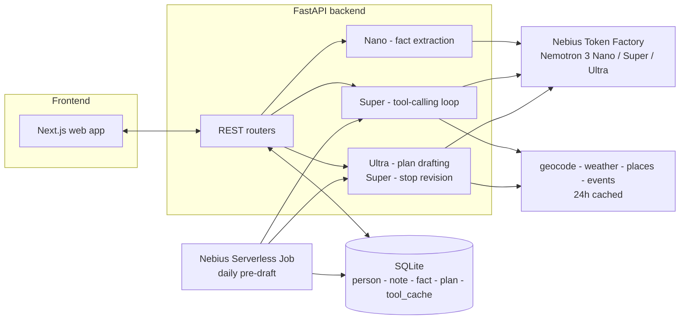

# Kindred

A private assistant that remembers what the people in your life like and turns it into
outing and birthday plans before you are scrambling. Log a quick note, Kindred extracts
structured facts, and it drafts a plan where every choice cites the note behind it.

Built for the Personal AI track: persistent memory (person profiles), reusable skills
(plan outing, suggest gift), user-chosen tools (places/events/weather), and private data
under the user's control.

## Architecture

One FastAPI backend orchestrates everything and routes each job to the smallest Nemotron
tier that can do it well, per the brief's advice to save Ultra for serious reasoning.



The pre-draft job reuses the exact same tool-calling and plan-drafting code paths as a
live request - it just runs on a schedule and saves straight to history instead of
waiting for the user to pick an option (see "Daily pre-draft job" below).

## Stack

- **Backend:** Python FastAPI, SQLite (`backend/`)
- **Frontend:** Next.js + Tailwind (`frontend/`)
- **Models:** Nemotron 3 Nano / Super / Ultra via Nebius Token Factory, routed by task

| Job | Model |
|---|---|
| Extract facts from notes | Nemotron 3 Nano |
| Tool calling, plan revisions, gift ideas | Nemotron 3 Super |
| Reconcile preferences, draft cited plans | Nemotron 3 Ultra |

See "Nemotron models: how and why" below for the full rationale.

## Setup

### Backend

```bash
cd backend
python -m venv .venv
.venv/Scripts/activate   # Windows; use source .venv/bin/activate on macOS/Linux
pip install -r requirements.txt
cp .env.example .env     # fill in NEBIUS_API_KEY and the three *_MODEL_ID vars
python -m app.db          # initializes the SQLite schema at app/kindred.db
uvicorn app.main:app --reload
```

Confirm the Nano and Ultra model IDs in the Token Factory console — the spec only
pins Super's ID (`nvidia/nemotron-3-super120b-a12b`).

### External tools

`search_places`, `search_events`, `get_weather`, `geocode` back the Super tool-calling
loop that gathers outing candidates. Every response is cached in SQLite for 24h.

| Tool | Primary | Fallback | Key needed? |
|---|---|---|---|
| `geocode` | Open-Meteo geocoding | — | No |
| `get_weather` | Open-Meteo forecast | — | No |
| `search_places` | Google Places (New) | OpenStreetMap Overpass | Only for Google |
| `search_events` | Ticketmaster Discovery | SeatGeek | Yes, one of the two |

Geocode and weather work out of the box. For places, the Overpass fallback needs no
key but the public instance is rate-limited and occasionally times out under load —
set `GOOGLE_PLACES_API_KEY` for a reliable demo. Events have no keyless option; set
`TICKETMASTER_API_KEY` or `SEATGEEK_CLIENT_ID`.

### Planning flow

`POST /plans/generate` runs Super's tool search, then Ultra drafts 2-3 cited plan
options grounded against the person's confirmed facts and Super's candidates:
a stop's `cited_fact_ids` are filtered to real fact ids and its `url` is dropped
unless it matches a url the tools actually returned, so Ultra can't slip in an
invented citation or venue. `POST /plans` saves the option the user picks to
history; past stop names are fed back into the next generation as "avoid
repeating these." `GET /dashboard/upcoming-dates` is pure date math (no model
call) - each person's key dates, rolled forward to their next occurrence and
sorted by days away.

`POST /plans/revise-stop` (P1) lets the user say "swap dinner for something
cheaper" from the plan view: Super re-searches with the instruction as the
keyword and returns a replacement for just that one stop, grounded the same
way as full generation. The frontend swaps it into the option in place.

### Daily pre-draft job (P1)

`app/predraft.py` is the same generation pipeline run automatically: for every
upcoming key date within 21 days that doesn't already have a plan, it drafts
one with Ultra and saves it with `status="draft"`. The dashboard then shows
"Draft ready" instead of "Plan this now" for that date. Locally:

```bash
cd backend
python -m scripts.predraft_plans
```

In production this is the entrypoint for a daily Nebius Serverless Job (cron).

### Frontend

```bash
cd frontend
npm install
cp .env.local.example .env.local
npm run dev
```

### Smoke-testing the Nemotron tiers

One test call to each tier (Day 1 checklist item):

```bash
cd backend
python -m scripts.smoke_test_nemotron
```

### Seeding demo data

Two rich demo profiles (Maya, Sam) with key dates, notes, confirmed facts, and
one saved plan already in history:

```bash
cd backend
python -m scripts.seed_demo
```

### Running backend tests

Routes are covered end-to-end with `pytest` + FastAPI's `TestClient`, each test against
a throwaway SQLite file. Nemotron calls are mocked so the suite runs with no Token
Factory credentials configured.

```bash
cd backend
pip install -r requirements-dev.txt
pytest
```

## Nemotron models: how and why

Three tiers, each sized to the task that calls it - Ultra is the only expensive call
and runs once per plan, so keeping Nano's per-note cost low matters more than shaving
Ultra's.

**Nano (30B) - `app/nemotron.py:extract_facts`.** Runs on every note capture. The task
is turning one or two sentences into a handful of structured facts (category, value,
sentiment, confidence) - a small model is plenty, and it's the call with by far the
highest volume in the product. Uses `response_format={"type": "json_object"}` for a
single round trip, with a fallback retry without that flag if a given model rejects
it, and Pydantic validates the result either way before it's shown to the user as
editable chips.

**Super (120B) - `app/tool_loop.py`, `app/planner.py:revise_stop`.** The only tier
wired up for tool/function calling in Kindred. Per the brief's own guidance ("save
Ultra for serious reasoning"), Super drives `search_places` / `search_events` /
`get_weather` / `geocode` through the standard OpenAI tool-calling format, capped at
~6 calls per search so a demo run can't run away on cost or latency. The same tier
handles single-stop revisions ("swap dinner for something cheaper") - a bounded,
well-scoped edit, not a full redraft, so it doesn't need Ultra either.

**Ultra (550B) - `app/planner.py:generate_plan_options`.** Called once per plan, after
Super has already gathered candidates - this is the "reconcile preferences against
facts and draft a cited plan" step, the one genuinely hard reasoning task in the
product (grounding stop choices in specific facts, avoiding repeats, keeping 2-3
options distinct). Its output is never trusted as-is: `cited_fact_ids` are filtered
to facts that actually exist, and a stop's `url` is dropped unless it matches a url
one of the tools actually returned.

**Where Token Factory helped.** The OpenAI-compatible API meant the backend is just
the standard `openai` Python SDK pointed at a different `base_url` - no
provider-specific client, no bespoke retry/parsing logic beyond what any
OpenAI-compatible deployment needs (`app/nemotron.py:get_client`). JSON mode made
structured fact extraction a single call instead of a parse-and-pray prompt. Standard
`tools=[...]` / `tool_choice="auto"` function-calling support meant the Super loop in
`app/tool_loop.py` could be written against the SDK's normal interface rather than a
custom agent protocol.

## Other Nebius services

- **Serverless Endpoint** - the backend's deployment target: `uvicorn app.main:app` is
  what the endpoint runs. Not yet deployed (see Day 6 of the build plan) - these docs
  describe the architecture it's built for.
- **Serverless Job** - `scripts/predraft_plans.py` is a standalone script with no web
  request/response involved, specifically so it can run as a daily cron job
  independent of the API process. See "Daily pre-draft job" above.

## Repo layout

```
backend/
  app/
    main.py       # FastAPI app + lifespan DB init + router wiring
    db.py         # SQLite connection + schema loader
    schema.sql    # person, key_date, note, fact, plan
    models.py     # Pydantic request/response schemas
    crud.py       # SQLite CRUD helpers
    nemotron.py   # tiered Nemotron client (Nano/Super/Ultra) + fact extraction
    json_utils.py # shared LLM JSON-response parsing
    tool_loop.py  # Super's tool-calling loop (places/events/weather/geocode)
    planner.py    # Ultra plan drafting + revise-one-stop + citation/url grounding
    dates.py      # pure date math (next occurrence, days until)
    dashboard.py  # upcoming-dates assembly (+ draft_plan_id lookup)
    predraft.py   # daily pre-draft job (flow D)
    config.py     # env-var loading
    tools/        # geocode, weather, places, events + 24h SQLite cache
    routers/      # people, notes, facts, planning, plans, dashboard endpoints
  scripts/
    smoke_test_nemotron.py
    seed_demo.py
    predraft_plans.py
  tests/          # pytest suite (CRUD, capture flow, tools, tool loop, planner, dashboard, predraft)
frontend/
  src/
    app/
      page.tsx                    # people list + add person + upcoming dates
      people/[id]/page.tsx        # person profile (server wrapper, Suspense)
      people/[id]/plan/page.tsx   # plan-an-outing flow (server wrapper, Suspense)
    components/
      UpcomingDates.tsx            # "Plan this now" / "Draft ready"
      person/   # KeyDates, NoteCapture, NotesList, FactsList, PlansList, PlanPageClient
    lib/
      api.ts         # typed fetch client for the backend
      constants.ts   # fact category labels/colors
```

## License

MIT — see [LICENSE](LICENSE).
