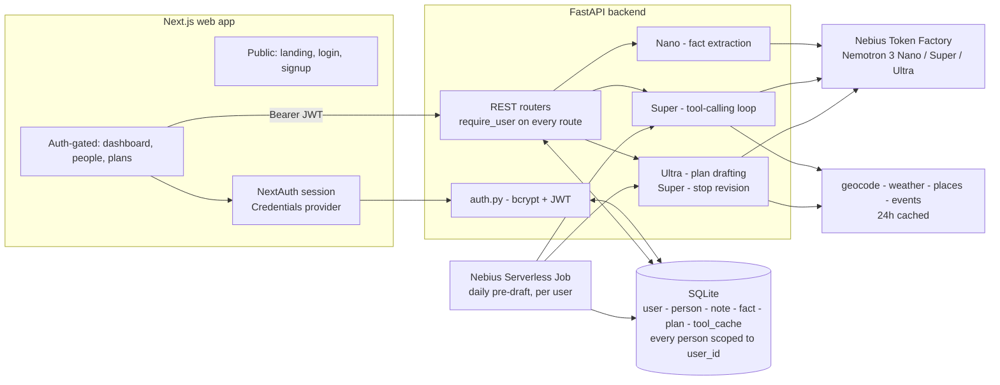

# Kindred

A private notebook for people whose attention moves faster than their memory. Someone
mentions, in passing, that they've always wanted to try pottery - and by the time it's
useful, it's gone. Kindred is built around the assumption that details slip through,
especially for ADHD/scattered-attention brains, so capture has to be as close to
zero-friction as possible: say it out loud the moment you hear it (voice capture, no
typing, no app-switching), and Nemotron turns it into a structured, searchable fact
instead of a memory you're hoping you'll still have later. When the date actually
arrives, Kindred drafts an outing or birthday plan where every choice cites the note
behind it - the two of you get credit for paying attention, even if the remembering
wasn't you.

Built for the Personal AI track: persistent memory (person profiles), reusable skills
(plan outing, suggest gift), user-chosen tools (places/events/weather), and private data
under the user's control.

> **Note on scope:** the original spec treats this as single-user ("one user, many people
> profiles" was an explicit non-goal). It's since grown real multi-user accounts - every
> person belongs to exactly one signed-in user, enforced at the database query level, not
> just in the UI. See "Authentication" below.

## Architecture

One FastAPI backend orchestrates everything and routes each job to the smallest Nemotron
tier that can do it well, per the brief's advice to save Ultra for serious reasoning.



The pre-draft job reuses the exact same tool-calling and plan-drafting code paths as a
live request - it just runs on a schedule and saves straight to history instead of
waiting for the user to pick an option (see "Daily pre-draft job" below).

## Stack

- **Backend:** Python FastAPI, SQLite (`backend/`)
- **Frontend:** Next.js + Tailwind (`frontend/`)
- **Models:** Nemotron 3 Nano / Super / Ultra via Nebius Token Factory, routed by task

| Job | Model |
|---|---|
| Extract facts from notes | Nemotron 3 Nano |
| Tool calling, plan revisions, gift ideas | Nemotron 3 Super |
| Reconcile preferences, draft cited plans | Nemotron 3 Ultra |

See "Nemotron models: how and why" below for the full rationale.

## Setup

### Backend

```bash
cd backend
python -m venv .venv
.venv/Scripts/activate   # Windows; use source .venv/bin/activate on macOS/Linux
pip install -r requirements.txt
cp .env.example .env     # fill in NEBIUS_API_KEY and the three *_MODEL_ID vars
python -m app.db          # initializes the SQLite schema at app/kindred.db
uvicorn app.main:app --reload
```

Confirm the Nano and Ultra model IDs in the Token Factory console — the spec only
pins Super's ID (`nvidia/nemotron-3-super120b-a12b`).

Also set `JWT_SECRET` in `backend/.env` for auth (any random string locally; generate a
real one for anything beyond local dev - see the comment in `.env.example`).

### External tools

`search_places`, `search_events`, `get_weather`, `geocode` back the Super tool-calling
loop that gathers outing candidates. Every response is cached in SQLite for 24h.

| Tool | Primary | Fallback | Key needed? |
|---|---|---|---|
| `geocode` | Open-Meteo geocoding | — | No |
| `get_weather` | Open-Meteo forecast | — | No |
| `search_places` | Google Places (New) | OpenStreetMap Overpass | Only for Google |
| `search_events` | Ticketmaster Discovery | SeatGeek | Yes, one of the two |

Geocode and weather work out of the box. For places, the Overpass fallback needs no
key but the public instance is rate-limited and occasionally times out under load —
set `GOOGLE_PLACES_API_KEY` for a reliable demo. Events have no keyless option; set
`TICKETMASTER_API_KEY` or `SEATGEEK_CLIENT_ID`.

### Planning flow

`POST /plans/generate` runs Super's tool search, then Ultra drafts 2-3 cited plan
options grounded against the person's confirmed facts and Super's candidates:
a stop's `cited_fact_ids` are filtered to real fact ids and its `url` is dropped
unless it matches a url the tools actually returned, so Ultra can't slip in an
invented citation or venue. `POST /plans` saves the option the user picks to
history; past stop names are fed back into the next generation as "avoid
repeating these." `GET /dashboard/upcoming-dates` is pure date math (no model
call) - each person's key dates, rolled forward to their next occurrence and
sorted by days away.

`POST /plans/revise-stop` (P1) lets the user say "swap dinner for something
cheaper" from the plan view: Super re-searches with the instruction as the
keyword and returns a replacement for just that one stop, grounded the same
way as full generation. The frontend swaps it into the option in place.

### Daily pre-draft job (P1)

`app/predraft.py` is the same generation pipeline run automatically: for every
upcoming key date within 21 days that doesn't already have a plan, it drafts
one with Ultra and saves it with `status="draft"`. The dashboard then shows
"Draft ready" instead of "Plan this now" for that date. Locally:

```bash
cd backend
python -m scripts.predraft_plans
```

In production this is the entrypoint for a daily Nebius Serverless Job (cron).

### Frontend

```bash
cd frontend
npm install
cp .env.local.example .env.local
npm run dev
```

`.env.local.example` also carries `NEXTAUTH_SECRET` (any string locally, a real
generated one in production - see the comment in the file) and `NEXTAUTH_URL`.

### Trying it out

Visit `http://localhost:3000` for the landing page, or sign in directly with the
seeded demo account (`python -m scripts.seed_demo` creates it):

```
judge@gmail.com / judge123
```

### Voice capture

The mic button in "Capture a note" (`useSpeechRecognition`, `frontend/src/lib/`)
transcribes speech to text entirely in the browser via the Web Speech API - no audio
leaves the device and no backend changes were needed. The moment speech ends, the note
is captured automatically (no extra click between hearing something and it being
saved); the resulting text goes through the exact same Nano fact-extraction path as a
typed note, chips and all.

Supported in Chrome, Edge, and Safari; not in Firefox - the mic button only renders
when the browser supports it, so typing is always the fallback. Nebius's Token Factory
doesn't currently list an audio-capable Nemotron model on this account (confirmed via
`models.list()`), which is why transcription happens client-side rather than through
an Omni-style model as the original spec sketch assumed - swapping that in later, once
available, would be a drop-in replacement for the browser API without touching the
Nano extraction step downstream.

### Smoke-testing the Nemotron tiers

One test call to each tier (Day 1 checklist item):

```bash
cd backend
python -m scripts.smoke_test_nemotron
```

### Seeding demo data

Two rich demo profiles (Maya, Sam) with key dates, notes, confirmed facts, and
one saved plan already in history:

```bash
cd backend
python -m scripts.seed_demo
```

### Running backend tests

Routes are covered end-to-end with `pytest` + FastAPI's `TestClient`, each test against
a throwaway SQLite file. Nemotron calls are mocked so the suite runs with no Token
Factory credentials configured.

```bash
cd backend
pip install -r requirements-dev.txt
pytest
```

## Nemotron models: how and why

Three tiers, each sized to the task that calls it - Ultra is the only expensive call
and runs once per plan, so keeping Nano's per-note cost low matters more than shaving
Ultra's.

**Nano (30B) - `app/nemotron.py:extract_facts`.** Runs on every note capture. The task
is turning one or two sentences into a handful of structured facts (category, value,
sentiment, confidence) - a small model is plenty, and it's the call with by far the
highest volume in the product. Uses `response_format={"type": "json_object"}` for a
single round trip, with a fallback retry without that flag if a given model rejects
it, and Pydantic validates the result either way before it's shown to the user as
editable chips.

**Super (120B) - `app/tool_loop.py`, `app/planner.py:revise_stop`.** The only tier
wired up for tool/function calling in Kindred. Per the brief's own guidance ("save
Ultra for serious reasoning"), Super drives `search_places` / `search_events` /
`get_weather` / `geocode` through the standard OpenAI tool-calling format, capped at
~6 calls per search so a demo run can't run away on cost or latency. The same tier
handles single-stop revisions ("swap dinner for something cheaper") - a bounded,
well-scoped edit, not a full redraft, so it doesn't need Ultra either.

**Ultra (550B) - `app/planner.py:generate_plan_options`.** Called once per plan, after
Super has already gathered candidates - this is the "reconcile preferences against
facts and draft a cited plan" step, the one genuinely hard reasoning task in the
product (grounding stop choices in specific facts, avoiding repeats, keeping 2-3
options distinct). Its output is never trusted as-is: `cited_fact_ids` are filtered
to facts that actually exist, and a stop's `url` is dropped unless it matches a url
one of the tools actually returned.

**Where Token Factory helped.** The OpenAI-compatible API meant the backend is just
the standard `openai` Python SDK pointed at a different `base_url` - no
provider-specific client, no bespoke retry/parsing logic beyond what any
OpenAI-compatible deployment needs (`app/nemotron.py:get_client`). JSON mode made
structured fact extraction a single call instead of a parse-and-pray prompt. Standard
`tools=[...]` / `tool_choice="auto"` function-calling support meant the Super loop in
`app/tool_loop.py` could be written against the SDK's normal interface rather than a
custom agent protocol.

## Authentication

Standard, from-scratch FastAPI + Next.js auth - no third-party auth service, no cost.

**Backend (`app/auth.py`, `app/routers/auth.py`).** Passwords are hashed with bcrypt,
never stored or logged in plaintext. `POST /auth/signup` and `POST /auth/login` both
return a signed JWT (14-day expiry); every other route depends on `require_user`
(`fastapi.security.HTTPBearer`), which decodes the token and 401s if it's missing,
malformed, or expired. Every table that holds a person's data is scoped to `user_id`
at the query level - `get_person(person_id, user_id)` returns `None` for a person that
doesn't exist *or* belongs to someone else, so a guessed id can't leak whether it
exists. `tests/test_auth.py` includes a cross-user isolation test: a second account
can't list, fetch, or delete the first account's people.

**Frontend (`src/lib/authOptions.ts`, `src/proxy.ts`).** NextAuth.js (`next-auth`) with
a Credentials provider whose `authorize()` calls the backend's `/auth/login` and
stores the resulting JWT in the NextAuth session (JWT session strategy, so no server
session table on the frontend either). `src/lib/api.ts` reads that token via
`getSession()` before every request and attaches it as `Authorization: Bearer <token>`
- existing components didn't need to change to become auth-aware. Registration isn't a
NextAuth concept, so `/signup` calls the backend directly, then signs in right after.

`next-auth` v5 (the version purpose-built for the App Router, with a cleaner `auth()`
API) is still in beta as of this build - `npm install next-auth@latest` itself
resolves to v4. Given that, v4 is the more defensible choice for something meant to
actually work reliably, even though its App Router support is a slightly later
addition to the library than v5's.

Route protection is a `proxy.ts` file (Next.js 16 renamed the `middleware.ts`
convention to `proxy.ts` - the build fails outright on the old name, not just a
deprecation warning) wrapping `next-auth/middleware`, matched against `/app/:path*`
and `/people/:path*`. The landing page, `/login`, and `/signup` stay public.

## Other Nebius services

- **Serverless Endpoint** - the backend's deployment target: `uvicorn app.main:app` is
  what the endpoint runs. Not yet deployed (see Day 6 of the build plan) - these docs
  describe the architecture it's built for.
- **Serverless Job** - `scripts/predraft_plans.py` is a standalone script with no web
  request/response involved, specifically so it can run as a daily cron job
  independent of the API process. See "Daily pre-draft job" above.

## Repo layout

```
backend/
  app/
    main.py       # FastAPI app + lifespan DB init + router wiring
    db.py         # SQLite connection + schema loader
    schema.sql    # user, person, key_date, note, fact, plan
    models.py     # Pydantic request/response schemas
    crud.py       # SQLite CRUD helpers, every person-scoped query takes user_id
    auth.py       # bcrypt hashing + JWT issuance/verification + require_user
    nemotron.py   # tiered Nemotron client (Nano/Super/Ultra) + fact extraction
    json_utils.py # shared LLM JSON-response parsing
    tool_loop.py  # Super's tool-calling loop (places/events/weather/geocode)
    planner.py    # Ultra plan drafting + revise-one-stop + citation/url grounding
    dates.py      # pure date math (next occurrence, days until)
    dashboard.py  # upcoming-dates assembly (+ draft_plan_id lookup), per user
    predraft.py   # daily pre-draft job (flow D), per user
    config.py     # env-var loading
    tools/        # geocode, weather, places, events + 24h SQLite cache
    routers/      # auth, people, notes, facts, planning, plans, dashboard endpoints
  scripts/
    smoke_test_nemotron.py
    seed_demo.py       # creates judge@gmail.com, then Maya/Sam under it
    predraft_plans.py  # loops every user, runs predraft.py for each
  tests/          # pytest suite - CRUD, auth, capture flow, tools, tool loop, planner,
                  # dashboard, predraft; `client` fixture is pre-authenticated,
                  # `raw_client` is bare (auth/401/cross-user tests)
frontend/
  src/
    app/
      page.tsx                    # public landing page (mission, how it works, features)
      app/page.tsx                # auth-gated dashboard (people list, add person, upcoming)
      login/page.tsx, signup/page.tsx
      api/auth/[...nextauth]/route.ts
      people/[id]/page.tsx        # person profile (server wrapper, Suspense)
      people/[id]/plan/page.tsx   # plan-an-outing flow (server wrapper, Suspense)
    components/
      AuthProvider.tsx             # NextAuth SessionProvider wrapper
      UpcomingDates.tsx            # "Plan this now" / "Draft ready"
      landing/                     # LandingNav (scroll-spy), Hero, Reveal, icons
      person/   # KeyDates, NoteCapture, NotesList, FactsList, PlansList, PlanPageClient
    lib/
      api.ts                   # typed fetch client, attaches the session's JWT
      authOptions.ts            # NextAuth config (Credentials provider, JWT session)
      constants.ts             # fact category labels/colors
      useSpeechRecognition.ts  # browser-native voice-to-text for note capture
    types/
      speech-recognition.d.ts  # ambient types for the Web Speech API
      next-auth.d.ts           # module augmentation for the custom accessToken field
    proxy.ts      # route protection (Next.js 16's middleware.ts replacement)
```

## License

MIT — see [LICENSE](LICENSE).
